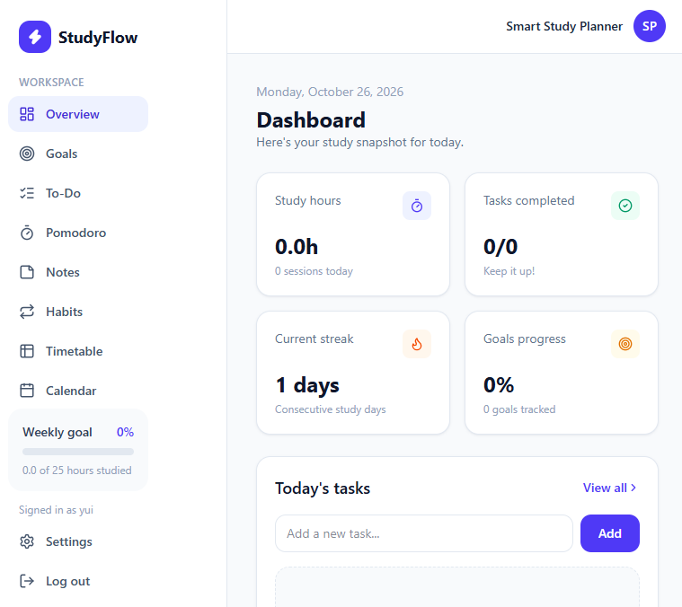
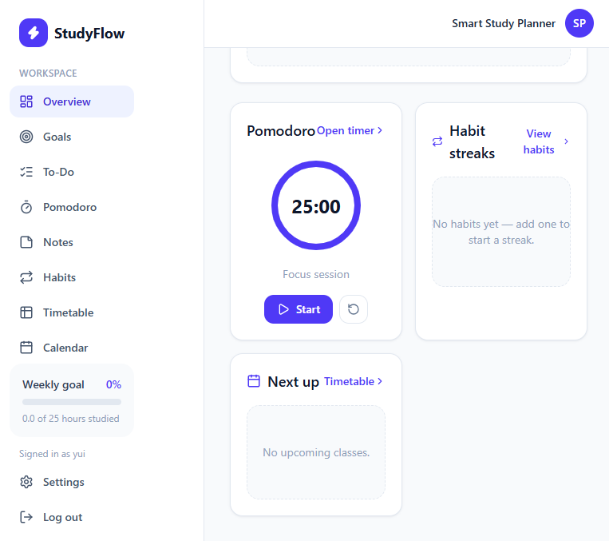

# StudyFlow – Smart Study Planner
StudyFlow is a web application designed to help students organize their studies, manage tasks/plans, and keep track of their academic work.
This was a collaborative MCA minor project where we worked together on both the frontend and backend.

## About the Project
### Problem
Most students, in school and college, manage their studies in pieces. Assignments are in one place, exam revision in another, and notes on paper or in different apps.
### Solution 
* Scattered tasks, timetable and notes → One dashboard brings everything together.
* Students lose focus → The Pomodoro timer gives focused sessions and logs study hours automatically.
* Big goals feel vague → Goals show a progress percentage and link to daily tasks.
* Habits are hard to keep → The habit tracker shows daily streaks.
* Classes and exam dates get forgotten → The timetable and calendar show what’s next on the dashboard.
* And many apps are complex, full of ads or paid, so we made StudyFlow simple, free and built for students.


## Features
* Design: Minimal, responsive and distraction-free interface.
* To-Do - add/manage tasks.
* Pomodoro - set a focus duration → work → take a break.
* Notes - Keep your daily notes in the app.
* Habits - add and track your daily habits and streaks.
* Timetable - set your daily timetable for classes or other activities.
* Calendar - View dates and keep track of scheduled activities.
* Goals – Create and manage study goals.

## Tech Stack
### Frontend
- React + Vite
- Tailwind CSS
### Backend
- Node.js
- Express.js
### Database
- PostgreSQL
### Authentication/security
- JWT
- bcrypt

## Screenshot




## Prerequisites
What does someone need installed before starting the project?
* Node.js - required to run the frontend and backend.
* PostgreSQL — required to create and run the project's database.
* Git — required to clone the repository and manage the project with version control.

## Installation & Setup
* ```
  git clone <repository-url>
     cd studyflow
  ```
* Create the ```studyflow``` database in pgAdmin.
* Run ```server/schema.sql``` in the Query Tool to create the tables.
* Create ```server/.env``` from ```server/.env.example``` and fill in their own password and secret.
* Create the React ```.env``` from ```.env.example``` (the VITE_API_URL line).
* Run ```npm install``` in the root folder, then ```npm install``` inside ```server/```

## Running the App
* Terminal 1: ```npm run dev``` in the root (opens at ```http://localhost:5173```).
* Terminal 2: ```npm run dev``` inside ```server/``` (runs on port 5000).
* The database starts empty, so register a new account before using the application.

## Environment Variables
| Variable | Purpose |
|---|---|
| `PORT` | Backend server port |
| `DATABASE_URL` | PostgreSQL connection |
| `JWT_SECRET` | JWT authentication secret |
| `CLIENT_ORIGIN` | Allowed frontend origin |
| `VITE_API_URL` | Backend API URL used by the frontend |

## Project Structure
Frontend
```
studyflow/
├── src/
│   ├── components/
│   ├── pages/
│   ├── hooks/
│   ├── context/
│   └── utils/
├── server/
│   ├── src/
│   └── schema.sql
├── public/
├── package.json
└── README.md
```
Backend
```
server/
└── src/
    ├── index.js
    ├── db.js
    ├── middleware/
    └── routes/
```

## Known Limitations & Future Scope
### Limitations
* Pomodoro study statistics are currently stored in the browser.
* Password reset functionality is not implemented yet.
* The project currently requires a local PostgreSQL database to run.
### Future Scope
* visual progress charts, so students can see their improvement over weeks and months, not just today
* personalization, such as themes and settings, and calm ambient soundtracks in the Pomodoro timer.
* smart reminders and scheduling suggestions based on a student’s own study patterns.
* a mobile app, so their plan travels with them.


## Team & Collaboration
* [Surbhi Verma](https://github.com/YuiSurbhi) - Backend
* [Elisha Chauhan](https://github.com/Elishachauhan584) - Frontend
* Yashu Pal - specific modules
